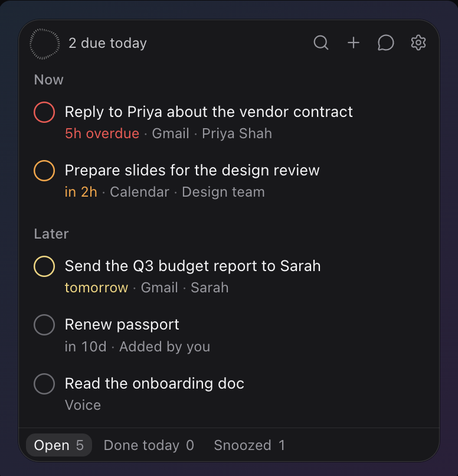
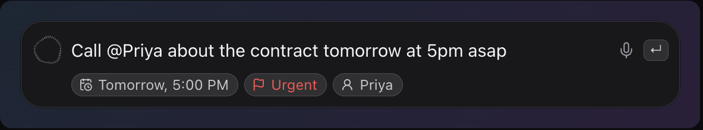
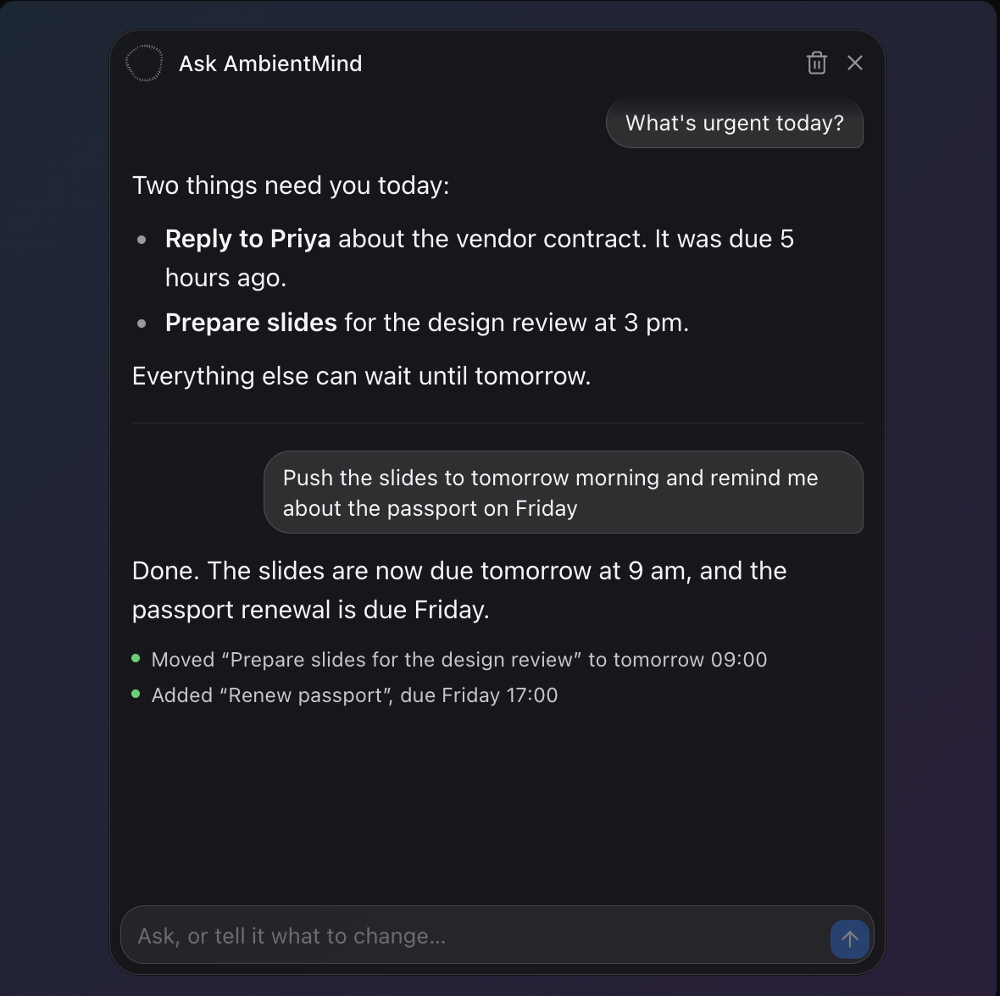
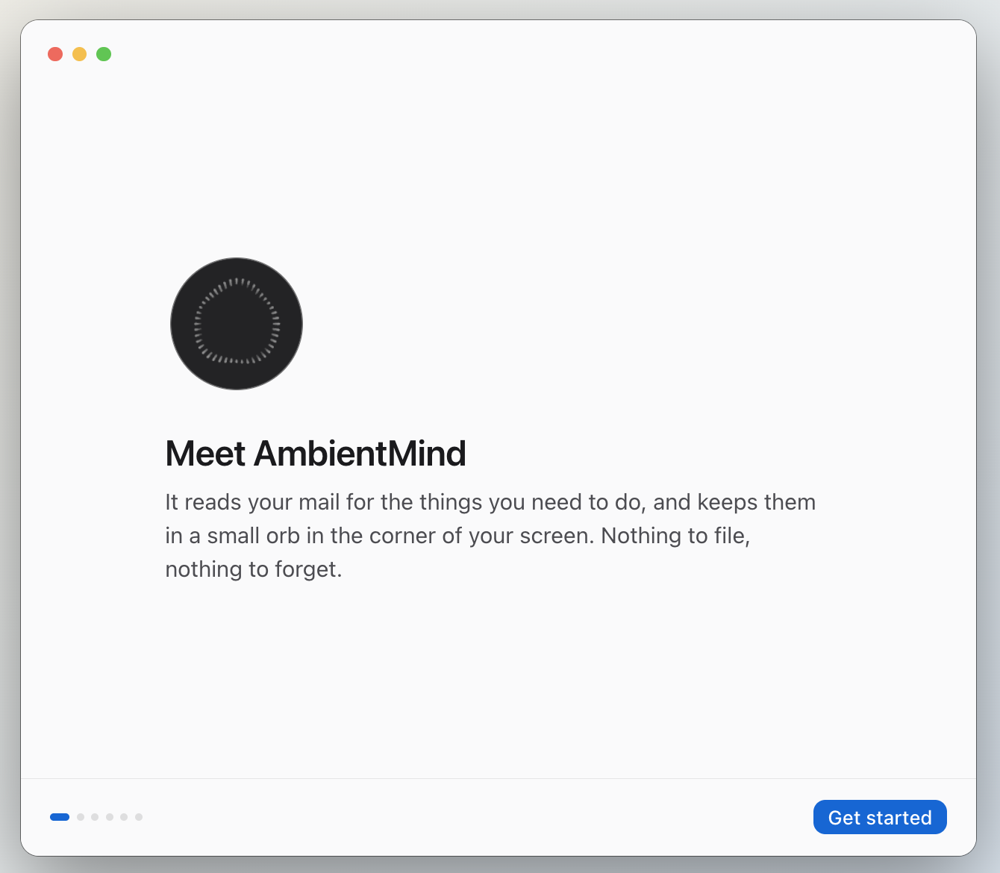
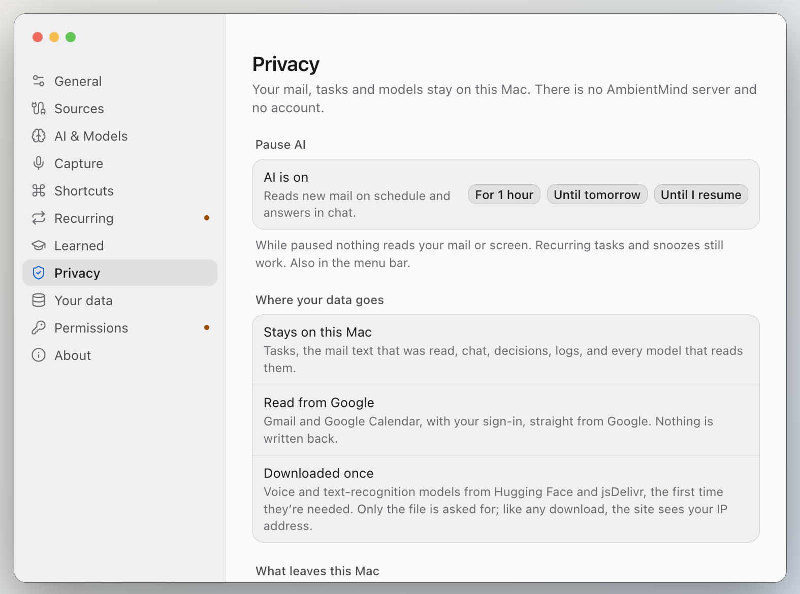
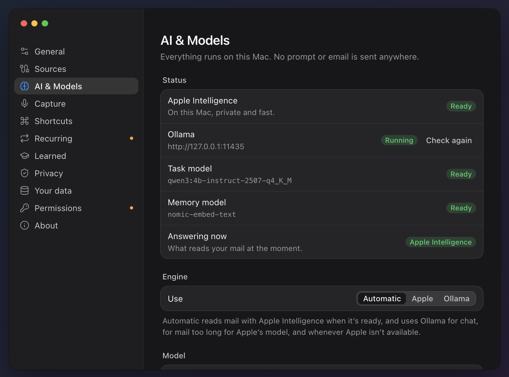

# AmbientMind

A to-do list that fills itself in. AmbientMind reads your Gmail and Google
Calendar for the things you need to do and keeps them in a small orb in the
corner of your screen. You can also add tasks by typing, by voice, or from
whatever is on screen. The AI runs on your own computer: no server, no
account, no analytics.

<p align="center">
  
</p>

## What it does

- **Finds tasks in your mail.** New Gmail is read by a local model. Each task
  has a deadline, a priority and the sentence it came from. Newsletters and
  receipts are filtered out before any model sees them.
- **Prepares you for meetings.** Calendar events become "prepare for…" tasks,
  due an hour before they start.
- **Quick Capture.** Press a shortcut and type or speak. "Call Priya about the
  contract tomorrow at 5pm asap" becomes a task due tomorrow at 5 PM, marked
  urgent.
- **Screen capture.** Turns what's on screen into a task with a summary, so you
  can act on it later. Off until you turn it on.
- **Chat.** Ask what's urgent, or tell it what to change: "push the slides to
  tomorrow morning". It only changes tasks you name, and it shows exactly
  what it changed.
- **Recurring tasks.** "Gym every Monday and Wednesday at 7am" repeats, and can
  appear in a separate Google Calendar.
- **Learns from you.** Tasks you keep deleting stop coming back. Everything it
  has learned is listed in Settings with an undo.

<p align="center">
  
</p>

<p align="center">
  
  &nbsp;
  
</p>

## Privacy

- Your mail, tasks, voice and screen text stay on your computer. Gmail is read
  with read-only access, straight from Google. Calendar is read-only too,
  unless you choose to put recurring tasks in their own Google calendar.
- The model is Ollama on `127.0.0.1`, or on a Mac also Apple's on-device
  model. No prompt goes to a cloud AI.
- Speech and text-recognition models are downloaded once, the first time
  they're needed.
- Settings → Privacy lists every request that left your computer. Settings →
  Your data shows what is kept and lets you export it, forget part of it, back
  it up encrypted, or erase everything.
- **Pause AI** stops all reading for an hour, until tomorrow, or until you
  resume.

<p align="center">
  
</p>

Read the full [privacy policy](PRIVACY.md) and [terms](TERMS.md).

## macOS and Windows

The overlay, Gmail, Google Calendar, Quick Capture, voice (Whisper), screen
capture, chat, recurring tasks, notifications and everything in Settings work
on both. A small signed Swift helper adds Mac-only features:

| | macOS | Windows |
| --- | --- | --- |
| Model | Apple Intelligence (macOS 26) or Ollama | Ollama |
| Apple Calendar, Reminders (two-way), your contact card | Yes | No |
| Voice | Apple speech or Whisper | Whisper |
| Screen capture | Focused window via Accessibility, then OCR | Display OCR |
| Quiet during calls and full-screen apps | Yes | No |
| Default shortcuts | ⌃⌥Space, ⌃⌥S, ⌃⌥C | Ctrl+Shift+A, S, C |
| Package | `.dmg` / `.zip` (Apple silicon) | NSIS installer (x64) |

## Getting started

### Requirements

- macOS on Apple silicon, or Windows 11 x64.
- [Ollama](https://ollama.com) with the task and memory models, unless you use
  Apple Intelligence for everything on a Mac:

  ```sh
  ollama pull qwen3:4b-instruct-2507-q4_K_M
  ollama pull nomic-embed-text
  ```

- A Google OAuth client of your own, which takes about ten minutes. See
  [Connecting Google](docs/google-setup.md).

<p align="center">
  
</p>

### Run from source

Everything the project installs stays inside this folder: the pinned Node
version, npm caches, app data, the Ollama models and build output all live in
`.local/`. The `./dev` wrapper sets that up. Use it for every command on macOS.

```sh
./dev setup              # Node from .node-version into .local/node, then npm ci
./dev ollama start       # a project-only Ollama on 127.0.0.1:11435
./dev ollama pull qwen3:4b-instruct-2507-q4_K_M
./dev ollama pull nomic-embed-text
./dev npm run helper     # Mac only: build the Swift helper
./dev npm run dev        # run the app
```

Windows has no `./dev`. Install the Node version in `.node-version`, then use
`npm ci` and `npm run dev`. App data goes to `%APPDATA%\AmbientMind`.

Useful commands:

| Command | What it does |
| --- | --- |
| `./dev npm test` | Logic, database and UI tests |
| `./dev npm run typecheck` | TypeScript |
| `./dev npm run gallery` | Every screen and state with mock data, at http://localhost:5199/gallery/ |
| `./dev packaged` | Launch the packaged Mac build with its data in `.local/data` |
| `./dev doctor` | Check that nothing was written outside the folder |

### Build for distribution

```sh
./dev npm run dist:release -- --mac    # or --win, on Windows
```

Release builds compile out every developer override, set the Electron fuses
and write to `.local/release-public/`. Only distribute these. `npm run dist`
makes a development build that trusts its launch environment. See
[SECURITY.md](SECURITY.md#release-builds-and-development-builds).

## How it works

An Electron app (React, Tailwind, TypeScript), with SQLite and sqlite-vec for
tasks and learned examples. Models are reached through Ollama's HTTP API or,
on a Mac, through the helper. Extraction is grammar-constrained, so the model
can only answer in the task schema, and code checks every task against the
text it came from. [docs/SYSTEM.md](docs/SYSTEM.md) covers the design: the
model choices, prompts, retrieval, data model, pipelines and the failures that
shaped them.

## Security

Report vulnerabilities privately, as described in [SECURITY.md](SECURITY.md).
The November 2026 audit and its fixes are in
[docs/SECURITY_AUDIT.md](docs/SECURITY_AUDIT.md).

## License

[MIT](LICENSE) © Suraj Singh Shekhawat. Third-party licences are in
[THIRD_PARTY_NOTICES.md](THIRD_PARTY_NOTICES.md).
